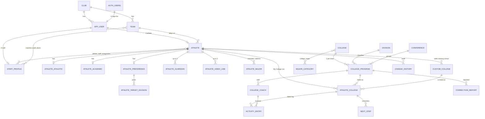

# College Recruiting App: Data Model (ER Plan) and Row-Level Security Rules for Supabase

*Planning only. No SQL or application code. Updated 2026-10-26 after the IPEDS enrichment and the WP0 decisions (see Sections 0, 1 and 9). Based on the current `CollegeRecruiting-app-MVP-DETAIL.md` (including your inline edits and answers) and the five files in `CollegeInfo\`. Draft 1, 2026-10-26.*

---

## 0. How your latest edits changed the design

| Your edit | Effect on the data model |
|---|---|
| No invitations; families self-register from a URL the club gives out | No `invite` table. Sign-up is open, so **security rests on RLS** (Section 8). **WP0 decision:** the sign-up form asks for a shared pilot code; no CAPTCHA and no email confirmation. |
| Consent record, Terms, Privacy: not MVP | No `consent_record` table. (Risk note in Section 9, item 8.) |
| Roster import, invites and password resets by admin: not needed | Athletes enter their own team and pick their own coordinator. No roster-import staging tables. |
| Email activity postponed | No digest, no "your coach updated" email, no notification preference columns. |
| Club Staff **can edit master college info** (D4) | Staff get write access to the college, program and coach tables. Those edits go to the change history too. |
| College PK = **UNITID** | `college.unitid` is the primary key. Programs hang off it (Section 1 explains why a separate program table is still required). |
| Competitiveness = rank within division, 6 percentile bands (D6) | Replaces the T1-T5 tier. Bands are **calculated in a view** from the stored division rank, not typed in. |
| Do not import AVCA rank, RPI rank, Region, Reg rank, reg-rank college name, Match score, Massey college name | Not stored. Mapping is in Section 5.3 and the load steps in the implementation plan (WP4). |

**Supabase Auth replaces much of Section 3.1 of the MVP doc.** Supabase stores passwords (hashed), sessions, email verification and reset tokens. So these planned tables are **not built**: `password_reset_request`, `login_event`, `session`, `invite`, `consent_record`. The doc's "lock after 5 failures" is not native (Supabase has rate limits, not a per-account lockout); see Section 9.

---

## 1. What the college files tell us (read this before loading data)

The five files in `CollegeInfo\` were enriched from IPEDS and their UNITIDs corrected on 2026-10-26 (details: `CollegeInfo\ENRICHMENT-README.md`). Originals are in `CollegeInfo\original\`.

| File | Rows | Distinct UNITIDs |
|---|---|---|
| NCAA D-I | 347 | 347 |
| NCAA D-II | 282 | 282 |
| NCAA D-III | 416 | 416 |
| NAIA | 203 | 203 |
| NJCAA | 414 | 414 |
| **All files** | **1,662** | **1,662** |

1. **There are 1,662 programs, not 5,000.** The earlier "about 5,000" is not what the files hold. `college` loads one row per UNITID. If every U.S. institution is ever wanted, the design supports it (`college` for all, `college_program` only for those with a team).
2. **UNITIDs are now unique.** The 11 wrong matches were fixed by the owner (rows corrected, merged duplicates removed: Clarion, Edinboro, The King's College, Utah State Eastern, Coastal Alabama - Brewton, Vermont State - Castleton and Johnson). Three campus ids are **owner-assigned and not IPEDS ids**: Minnesota North - Mesabi Range 17373502, Minnesota North - Vermilion 17373505, Lock Haven 213613. `college.unitid` must therefore be a plain integer key with no foreign key to an IPEDS table. Those three rows carry the parent institution's IPEDS data.
3. **`college_program` still has its own ID,** because later sports or divisions can give one UNITID several programs. In the pilot it is one-to-one with `college`.
4. **Columns added by the enrichment** (19 per file): `ipeds_unitid_check`, `proposed_unitid`, `ipeds_name`, `zip`, `website_url`, `net_price_url`, `latitude`, `longitude`, `ipeds_control`, `campus_setting`, `locale_code`, `undergrad_enrollment`, `enrollment_term`, `tuition_in_state`, `tuition_out_of_state`, `tuition_year`, `admit_rate`, `selectivity`, `major_categories` (semicolon list), `major_category_count`. Support files: `major_category.csv` (25 rows), `college_major.csv` (26,351 rows), `zip_location.csv` (33,144 rows). The `ipeds_unitid_check`, `proposed_unitid` and `ipeds_name` columns are load-time QA only.

   | Filter | Supported? |
   |---|---|
   | Division, conference, state, public/private, name, competitiveness band | Yes |
   | School size, campus setting, selectivity, major | **Yes** (enrichment) |
   | Distance from home | Data is ready (lat/long + ZIP table), **not in the pilot** (WP0) |

5. **Coach data is thin outside NCAA D-I:** head coach filled for 98% of D-I, 92% of D-II, 81% of D-III, 27% of NAIA, and 6% of NJCAA (25 of 414). Recruiting-coordinator names exist for 130 programs in total.
6. **Coach email quirks:** 18 programs (14 in D-I) use the same email for head and assistant coach (for example one shared team inbox), so **do not make coach email unique per program.** A few emails are not in a clean single-address form and need cleanup. No row has an email without a name.
7. **Rank:** the Massey rank is filled for 1,520 of the 1,662 rows (all 347 of D-I, 274 of 282 D-II, 405 of 416 D-III, 193 of 203 NAIA, 301 of 414 NJCAA). Rows with a blank rank get **no competitiveness band** ("Unranked"), and the filter must say so.
8. **Match quality:** UNITID quality was checked by comparing names and cities to IPEDS (the source `HD2025_INSTNM` column is just the IPEDS name of the UNITID, so it cannot validate it). After the fixes: 1,637 ok, 20 name differs (SUNY and similar wording), 2 shared parent data, 3 campus check (IPEDS record is a different campus of the same school). On rows whose UNITID changed, `HD2025_INSTNM` still holds the old school's name; it is not imported.

---

## 2. Design principles

1. **Postgres rules first.** Required fields, value ranges, "one open next step per college", "exactly one primary guardian" and similar rules live in the database (NOT NULL, CHECK, unique indexes, triggers) so no screen or coordinator edit can break them.
2. **Every athlete-owned table carries `athlete_id`**, even grandchildren (activity entry, next step). It makes RLS policies simple and fast. A composite foreign key keeps the copy honest (an activity entry's `athlete_id` must equal its list entry's `athlete_id`).
3. **Fixed lists vs. admin-editable lists.**
   - *Enum types* (changed only by a migration, because code depends on the values): user role, user status, list stage, next-step status, entry source, activity direction, outcome, coach employment status, program status, guardian relationship, preferred contact, handedness, athlete program type, public/private, campus setting.
   - *Lookup tables* (editable by admin or staff without a release): division, position, major category, activity type, next-step type, conference, U.S. state, sport.
4. **No hard deletes from the app.** Activity entries and list entries use `archived_at` / `deleted_at`. Only admin account-deletion (a server function) removes data.
5. **Audit by trigger.** The app never writes change history. A trigger records every change to athlete data and master college data, with `auth.uid()` as the author.
6. **Derived values are views, not columns:** profile completeness %, last activity date, current next step, overdue count, competitiveness band, current grade.
7. **One club now, many later.** `club` exists, and `team` and `app_user` point at it. Other tables do not carry `club_id`, because RLS works by athlete and role, not by club.

---

## 3. Accounts and authentication in Supabase

| Topic | Plan |
|---|---|
| Where logins live | Supabase's own `auth.users` (managed; never altered by us). Our table `app_user` is 1:1 with it. |
| Username | Stored in `app_user.username` (unique, case-insensitive, 4-30 chars, letters/numbers/dot/underscore). **Supabase signs in by email, not username**, so the sign-in screen calls a small server-side function that finds the email for the username and signs in. The email is never returned to the browser, and the error message is the same for "no such user" and "wrong password". |
| Email | The real family email is the Supabase login email, and **email is the sign-in** for the pilot (WP0). **One email = one account**, so siblings need different emails (confirmed). |
| Role | Stored in `app_user.role` (athlete / staff / admin). **Never stored in user-editable metadata**; a user could rewrite that. RLS reads the role from our table. |
| Sign-up | Open sign-up with a **shared pilot code** (WP0); email confirmation OFF and no CAPTCHA. The code must be checked on the server side (not only in the browser) before the account works. A database trigger creates the matching `app_user` row with role = athlete and stores the one-line acknowledgement (checkbox + timestamp). |
| Staff and admin accounts | Staff register through the same URL, then an admin promotes them (role change plus a `staff_profile` row) from the Users page. The first admin is set by you directly in the database. Role changes go through a server function that checks the caller is an admin. |
| Athlete record | Created by the app at the end of onboarding step 1 (first/last name, DOB, grad year, state, team, primary position). One athlete per user (unique). Until then the user has an account but no athlete row. |
| Coordinator link | **Pilot: admin assigns in the dashboard** (Section 5, `athlete_staff_assignment`). Athlete self-pick is deferred. |
| Sessions | Supabase defaults; the doc's 2-hour staff idle timeout is a Supabase setting (available on paid plans). |
| Auth emails | Only password-reset messages are sent, since email confirmation is off. **Supabase's built-in email sender has a very low send limit and is meant for testing**; the pilot uses **Resend** as the SMTP provider. |

---

## 4. Entity-relationship overview

**Relationships in words**
- A club has teams; an athlete belongs to one team.
- A login (`auth.users`) has exactly one `app_user`. An `app_user` is either an athlete (one `athlete` row) or staff (one `staff_profile` row) or an admin.
- Athlete-to-staff is many-to-many through `athlete_staff_assignment` (a staff member sees only athletes in this table).
- An athlete has one athletic row, one academic row, one preferences row, up to 2 guardians, up to 3 video links, target divisions, and major choices.
- A college (UNITID) has one or more programs (a program = a volleyball team in a division). A program has many college coaches.
- An athlete's list entry points to **either** a master program **or** an athlete-added custom college (exactly one).
- A list entry has many activity entries and many next steps (but only one *open* next step).

---

## 5. Table catalog

Notation: **PK** primary key; **FK** foreign key; **UQ** unique; **CK** check; all tables also have `created_at` and `updated_at` (set by trigger). Athlete-owned tables also have `created_by` and `updated_by` (set by trigger from the signed-in user, never trusted from the browser).

### 5.1 Club and accounts

**club**: PK id; name, short_name, time_zone (default America/Chicago), season_label. One row.

**team**: PK id; FK club; name, grad_year_group, season_label, level, head_coach_name, active. UQ (club, name, season_label).

**app_user**: PK user_id = FK to `auth.users` (delete cascades). username (UQ lowercased; CK pattern and length), display_name, role (enum), status (enum: active, disabled), FK club, time_zone.
- Dropped from the earlier doc because Supabase handles them: failed-login counter, locked-until, last login, email-verified flag, must-change-password, digest preference (email postponed).

**staff_profile**: PK/FK user_id (to `app_user`; role must be staff or admin, enforced by trigger); first_name, last_name, title (Recruiting Coordinator, Team Coach, Director), email, phone, active.

**staff_team**: PK (staff user_id, team). Which teams a staff member coaches. Informational in the MVP; used to pre-filter the assignment pick-list.

**athlete_staff_assignment**: PK id; FK athlete; FK staff user_id; role_on_athlete (primary / secondary); assigned_by; assigned_at. UQ (athlete, staff). Unique index: at most one *primary* per athlete.

### 5.2 Athlete (split into four 1:1 tables so the athlete and a coordinator can edit different tabs without colliding)

**athlete** (identity and contact): PK id; FK user_id (UQ: one athlete per login); FK team; first_name, last_name, preferred_name; date_of_birth; graduation_year (CK sane range); FK sport (volleyball); program_type (enum, women's/men's); home_city; home_state (FK state); home_zip (CK exactly 5 digits); athlete_email (CK basic format); athlete_phone; preferred_contact (enum); jersey_number; `version` number (bumps on each save, used for the "changed since you opened it" warning).
- NOT NULL: names, DOB, graduation_year, sport, program_type, home_state, team.
- Trigger: DOB must put the athlete in the 14-18 range *when the row is created* (checked at insert only, because a CHECK cannot reference today's date safely).

**athlete_athletic**: PK/FK athlete_id; primary_position (FK position, NOT NULL), secondary_position (FK; CK different from primary); height_in, standing_reach_in, approach_touch_in, block_touch_in (CK plausible ranges); dominant_hand (enum); club_team_name, club_level; club_coach_name/email/phone; hs_coach_name/email/phone; awards_text, stats_summary_text, about_me_text (CK length limits); `version`.

**athlete_academic**: PK/FK athlete_id; hs_name, hs_city, hs_state; gpa_unweighted (CK 0.00-4.00), gpa_weighted (CK 0.00-5.50), gpa_updated_on; class_rank_text; major_undecided (bool); sat_total (CK 400-1600), sat_date; act_composite (CK 1-36), act_date; planned_test_dates_text; ncaa_ec_status (enum: not started / registered / unsure), naia_status (enum); counselor_name, counselor_email; `version`. (No NCAA Eligibility Center ID stored, per D10.)

**athlete_preference**: PK/FK athlete_id; `competitiveness_bands` (list of 1-6; NOT NULL, at least one; CK each in 1-6 -- see note); playing_time_expectation (enum); preferred_regions (list of region codes); max_distance_miles (NULL = no limit; CK > 0); school_sizes (list: small/medium/large); control_types (list: public/private); campus_settings (list); academic_importance (CK 1-5); cost_need (enum); must_haves_text; deal_breakers_text; ideal_school_text; last_reviewed_on; `version`.
- **Note on competitiveness:** your D6 bands replace the five-option wording in the MVP doc. I store which of the six bands the athlete is open to (multi-select), because "Top 10% of D-III" and "Top 10% of D-I" mean different things and the athlete also picks divisions. Confirm this is what you want.
- Short fixed lists (size, public/private, setting, regions) are stored as lists inside the row. That is simpler than extra tables; each element is checked against the allowed values with a CHECK.
- A row exists only after the athlete finishes preferences step 2, so "row missing" = "preferences not done".

**athlete_target_division**: PK (athlete, division); FK division; interest (enum: top choice / open to).

**athlete_major**: PK (athlete, major_category, kind); kind (intended / interest). Trigger: at most 3 *intended*.

**athlete_guardian**: PK id; FK athlete; relationship (enum), full_name, email, phone, is_primary (bool), ok_to_share (bool). Trigger: max 2 per athlete. Unique index: one primary per athlete.

**athlete_video_link**: PK id; FK athlete; label, url (CK starts with http:// or https://), sort_order. Trigger: max 3 per athlete.

Also on the athlete's profile but **not stored**: social handles and external-profile link go into `athlete_athletic` as three text columns (instagram, x, tiktok) plus `external_profile_url` and `game_film_url`. (Listed here so the Links tab is fully covered.)

### 5.3 College master data (shared; see Section 8 for the load)

**division** (lookup): PK code (NCAA_D1, NCAA_D2, NCAA_D3, NAIA, NJCAA); label, sort_order, active.

**conference** (lookup): PK id; name; FK division. UQ (division, name). Built from the distinct values in the files.

**college**: **PK unitid (integer, from IPEDS)**.
- name (NOT NULL), short_name, city, state (FK state), zip, latitude, longitude, website_url, control (enum public/private; files give Public/Private, `ipeds_control` also has Private for-profit), enrollment, enrollment_term, campus_setting (enum), locale_code, selectivity (enum), admit_rate, religious_affiliation (not in the files), cost_url (= `net_price_url`), tuition_in_state, tuition_out_state, tuition_year.
- **`unitid` is a plain integer key, not tied to an IPEDS table:** three rows use owner-assigned ids (Section 1, item 2).
- Name, city, state and control come from the source file; everything else comes from the IPEDS enrichment already in the files (Section 1, item 4) and is nullable.
- CK: latitude -90..90, longitude -180..180, enrollment > 0.

**college_major**: PK (unitid, major_category). Loaded from `college_major.csv` (26,351 rows). Categories come from `major_category.csv` (25 codes, e.g. BUSN, HLTH, KINE).

**college_program**: PK id (own surrogate key; see Section 1).
- FK unitid (NOT NULL); FK sport (volleyball) and program_type (women's); FK division (NOT NULL); FK conference.
- `program_name` (the name as it appears in the files, e.g. "Vermont State University - Castleton"; NOT NULL); `campus_label` (blank unless a UNITID has several teams in one division).
- program_url, questionnaire_url, camps_url, instagram_url, x_url, last_season_record.
- `division_rank` (from the Massey rank), `division_rank_season`, `rating` (optional, from the Massey rating).
- last_verified_on (NOT NULL), verified_by, data_source, status (enum: active / program dropped / needs review).
- UQ (unitid, division, sport, program_type, campus_label).
- **Not stored:** the Tier column (replaced by the percentile bands), AVCA rank, RPI rank, Region, Reg rank, and the match-quality columns.
- Competitiveness band is calculated: rank divided by the count of *ranked* programs in the same division and season → Top 10% = band 1, 10-20% = band 2, 20-30% = 3, 30-40% = 4, 40-50% = 5, 50%-rest = 6. No rank = unranked (no band). Boundary rule (does exactly 10% fall in band 1 or 2?) needs one decision; I suggest "up to and including 10%" is band 1.

**college_coach**: PK id.
- FK program (nullable) **or** FK custom_college (nullable); CK exactly one is set.
- full_name (NOT NULL), title (enum: head, associate head, assistant, recruiting coordinator, director of ops, other), email (CK basic format; **not unique**), phone, is_primary_recruiting_contact (unique index: at most one per program), recruits_note, staff_page_url, social_handles, employment_status (enum: current / departed / unknown; NOT NULL), last_verified_on, source.
- `owner_athlete_id`: NULL = shared master record; set = private to that athlete (and their staff).
- From the files: head coach, assistant coach and recruiting coordinator (each a name and an email) become up to three rows per program. Blank slots create no row.

**custom_college**: PK id; FK owner athlete (NOT NULL); name, city, state, division (nullable), conference_text, website_url, notes; status (enum: private / promoted / rejected); promoted_program_id (FK, nullable). **Not built for the pilot** (MVP 12.5).

**zip_location** (lookup): PK zip; latitude, longitude. Loaded once from `zip_location.csv` (33,144 rows, Census 2020 ZIP-area centres). Needed only for the distance filter, which is **not in the pilot**, so loading it can wait.

### 5.4 Athlete's college list, activity and reminders

**athlete_college** (My College List entry): PK id; FK athlete; FK program (nullable) **or** FK custom_college (nullable); CK exactly one is set.
- priority (CK 1-4, default 3), stage (enum: researching, shortlisted, contacted, in conversation, camp/visit, offer, committed, closed; default researching), closed_reason (enum), added_on, why_i_like_text, notes_text, FK main_coach (a coach of the same program; trigger-checked), questionnaire_completed_on, `archived_at`, added_by, `version`.
- CK: stage = closed ⇔ closed_reason is not null.
- UQ (athlete, program) and UQ (athlete, custom_college). Restoring an archived entry reuses the row, so a school can never appear twice.
- Trigger: at most 30 *non-archived* entries per athlete (the limit is read from `app_setting`).
- Also UQ (id, athlete_id) so child tables can use the composite foreign key.

**activity_entry**: PK id; FK list entry plus `athlete_id` (composite FK, Principle 2).
- activity_date (NOT NULL, CK not before 2020 and not more than 1 day in the future), activity_time (optional), FK activity_type, direction (enum: I contacted them / They contacted me / n/a), FK coach (optional, trigger-checked to belong to the same program), coach_name_text, summary (NOT NULL, CK ≤ 200 chars), details_text, outcome (enum), follow_up_needed (bool), attachment_url (CK http/https), source (enum: athlete / staff / system), entered_by, `deleted_at`, `deleted_by`.
- Trigger: direction is required when the activity type's `requires_direction` flag is true.
- System entries (stage/priority/added-to-list) are written only by a database trigger and cannot be edited or deleted by anyone through the app.

**next_step**: PK id; FK list entry plus `athlete_id` (composite FK).
- description (NOT NULL, CK ≤ 200 chars), due_date (NOT NULL), FK step_type, status (enum: open / done / skipped), completed_at, completed_by, snooze_until (CK ≥ due date if set), created_source (enum: athlete / staff / system), created_by.
- **Unique index: one open next step per list entry.**
- CK: status open ⇔ completed_at is null.

### 5.5 Audit, corrections and configuration

**change_history**: PK id (big sequence); athlete_id (NULL for master-data edits); table_name; record_id; change_type (created / updated / deleted / restored); old_values and new_values (JSON of only the changed columns); changed_by; changed_by_role; changed_at. Insert-only. One row per record change (the screen expands it into field-by-field). Written by triggers on every athlete-owned table and on `college`, `college_program`, `college_coach`.
- Date of birth is masked when displayed.

**correction_report**: PK id; FK program (nullable) **or** FK coach (nullable), CK exactly one; reported_by; what_is_wrong; suggested_value; status (open / fixed / rejected); resolved_by, resolved_at, admin_note.

**app_setting**: PK key; value; description. Holds list cap (30), "narrow your list" threshold (15), overdue defaults.

**Lookup tables** (PK code, label, sort_order, active): `sport`, `position`, `major_category`, `activity_type` (+ requires_direction), `next_step_type`, `state` (+ region code). The position list in the MVP doc differs slightly from the PLAN doc (your edit merged Libero/Defensive Specialist); the lookup table follows your edit.

---

## 6. Rules that need triggers or functions (cannot be plain constraints)

| # | Rule | Where it lives |
|---|---|---|
| 1 | Max 30 non-archived colleges per athlete | Trigger on `athlete_college` |
| 2 | Max 2 guardians, max 3 video links, max 3 intended majors | Triggers |
| 3 | Athlete age 14-18 at creation | Trigger on `athlete` insert |
| 4 | Direction required for email/call/text/video | Trigger on `activity_entry` |
| 5 | Main coach / activity coach must belong to the same program | Triggers |
| 6 | `athlete_id` copied on children must match the list entry | Composite foreign key (constraint) |
| 7 | Stage or priority change writes a System activity entry | Trigger on `athlete_college` |
| 8 | `created_by` / `updated_by` / `source` / `entered_by` set from the signed-in user and role, never from the browser | Triggers (stops an athlete from labelling an entry "staff" or "system") |
| 9 | Optimistic concurrency: reject a save if `version` is stale | Trigger or save function |
| 10 | Audit rows for every change | Triggers on athlete tables and master college tables |
| 11 | `updated_at` maintenance | Trigger |
| 12 | A staff_profile may exist only for staff/admin users | Trigger |
| 13 | New sign-up creates `app_user` (role = athlete) | Trigger on `auth.users` |
| 14 | Protect `role`, `status`, `user_id` from self-edit | Column-level permissions (RLS cannot limit columns) |

---

## 7. Views the screens will read

| View | Used by | Notes |
|---|---|---|
| program_search | Find Colleges | Joins college, program, division, conference; includes the calculated competitiveness band and, later, distance from the athlete's ZIP. |
| my_list | My College List | List entry + program + last activity date + current open next step + days silent. |
| next_steps_due | Home, All Next Steps | Open steps grouped overdue / this week / later, using the club time zone. |
| athlete_completeness | Profile %, roster | Counts filled required/"complete" fields. |
| staff_roster | Coordinator roster | One row per assigned athlete: team, grad year, profile %, # colleges, last activity, # overdue. |
| change_history_display | Change panel | Field-by-field expansion with DOB masked. |

**Important Supabase gotcha:** a view runs with its *owner's* rights and **ignores RLS by default**, which would expose every athlete's data. Every view that reads athlete-owned tables must be created so that it runs with the *caller's* rights (the `security_invoker` setting, Postgres 15+). Treat it as a checklist item for each view.

---

## 8. Row-level security (RLS) rules

### 8.1 Ground rules

1. **RLS is enabled on every table in the `public` schema**, with no exceptions. A table with RLS off is readable by anyone holding the public key.
2. **Default deny.** A table with no matching policy returns nothing and rejects writes.
3. **Only the `authenticated` role gets policies.** Signed-out visitors (`anon`) get nothing; sign-in works through Auth and the username-lookup function.
4. **Roles come from `app_user.role`**, read by helper functions, never from user-editable metadata.
5. **Separate policies per action** (select, insert, update, delete), each with a `USING` rule (which existing rows) and, for insert/update, a `WITH CHECK` rule (what the row must look like afterwards). The `WITH CHECK` stops a user from re-pointing a row to another athlete.
6. **The service key (admin key) is never in the browser.** Bulk loads and admin server functions use it; it bypasses RLS by design.
7. **Policy performance:** helper functions are called as `(select fn())` so Postgres evaluates them once per query, and every `athlete_id` column is indexed.

### 8.2 Helper functions (kept in a non-exposed schema, run with elevated rights, fixed search path)

| Function | Returns |
|---|---|
| `current_role()` | the caller's role from `app_user` (null if disabled) |
| `is_admin()` | true if role = admin and status = active |
| `is_staff()` | true if role is staff or admin and status = active |
| `my_athlete_id()` | the athlete row belonging to the caller, if any |
| `can_access_athlete(athlete_id)` | true if it is the caller's own athlete, **or** the caller is staff with a row in `athlete_staff_assignment` for that athlete, **or** the caller is admin |
| `can_write_master()` | true for staff and admin (per D4) |

A disabled account (`status = disabled`) fails every helper, so disabling a user cuts off data access immediately even before their session expires.

### 8.3 Policy matrix

**S** = select, **I** = insert, **U** = update, **D** = delete. "Own" = the caller's own athlete. "Assigned" = athletes the staff member is assigned to.

| Table | Athlete | Staff | Admin |
|---|---|---|---|
| club, team | S | S | SIUD |
| app_user | S own row; U own display_name/time_zone only | S own row | SIUD (role/status changes via server function) |
| staff_profile, staff_team | S (a club directory, so athletes can see their coordinators) | S all; U own profile | SIUD |
| athlete_staff_assignment | S own; **I and D own** (chooses or removes a coordinator, target must be a staff user) | S own rows only; **no insert, no delete** | SIUD |
| athlete | S own; I own (once; role must be athlete); U own | S, U assigned; no I, no D | SIUD |
| athlete_athletic, _academic, _preference | S, I, U own | S, I, U assigned | SIUD |
| athlete_target_division, athlete_major, athlete_guardian, athlete_video_link | SIUD own (these are editable lists) | SIUD assigned | SIUD |
| athlete_college | S, I, U own (archive = update) | S, I, U assigned | SIUD |
| activity_entry | S, I own; U own **except** system entries | S, I assigned; U assigned **except** system entries | SIUD |
| next_step | S, I, U own | S, I, U assigned | SIUD |
| custom_college | SIUD own | SIUD assigned | SIUD |
| division, conference, state, sport, position, major_category, activity_type, next_step_type, app_setting | S | S | SIUD |
| college, college_major, college_program | S | **S, I, U** (D4); no delete | SIUD |
| college_coach (master rows, owner null) | S | **S, I, U**; no delete | SIUD |
| college_coach (private rows, owner = athlete) | SIUD own | SIUD for assigned athletes' rows | SIUD |
| zip_location | S | S | SIUD |
| change_history | S only rows about own athlete **where changed_by_role is staff or admin** | S rows for assigned athletes and all master-data rows | S all |
| correction_report | I; S own reports | S all; U (resolve) | SIUD |

Never granted to anyone through the app (all roles): **DELETE on `activity_entry`, `athlete_college`, `athlete`**; **INSERT/UPDATE/DELETE on `change_history`**; INSERT on `app_user`. Those happen only through triggers or admin server functions.

### 8.4 Special cases to design carefully

1. **Staff cannot assign themselves.** If staff could insert into `athlete_staff_assignment`, any coordinator could read any athlete. Only the athlete (own record) or an admin can create a row.
2. **A stranger who registers sees almost nothing:** their own (empty) account, the shared college database and lookups. They cannot see any other athlete. Because sign-up is open, the college database (including coach emails) is visible to anyone who registers. Decide whether that is acceptable (the data is mostly public staff pages).
3. **Private coaches and colleges:** the master-data SELECT policy is "owner is null **or** `can_access_athlete(owner_athlete_id)`", so athlete-added contacts are private to that athlete and their staff.
4. **System activity entries** are written only by trigger. The UPDATE policy excludes `source = 'system'`; there is no DELETE.
5. **Edits by staff are visible:** `entered_by` and `source` are filled by trigger from the real caller; the athlete's screens read the staff member's name from `staff_profile`.
6. **Role escalation:** a user must not be able to change their own `role`, `status` or `user_id`. Use column-level permissions plus a trigger as a second guard. Role changes go through a server function that checks `is_admin()`.
7. **Master-data edits by staff** affect every athlete, so every change is audited (`athlete_id` is null on those audit rows) and `last_verified_on` / `verified_by` are updated whenever a coordinator touches a record.
8. **Account deletion** (a parent's request): an admin-only server function deletes the athlete and all dependent rows in a defined order, and the audit rows for that athlete.
9. **Data export:** an admin-only server function returns the athlete's data. (Athlete self-service export is a later feature.)
10. **Realtime:** do not turn on Supabase Realtime for the athlete-owned tables in the MVP; it adds another access path to verify.

### 8.5 RLS test plan (do before real data goes in)

Create three test accounts (athlete A, athlete B, staff assigned to A only) plus an admin, and confirm:
- A cannot read, insert into, or update anything belonging to B (including by guessing IDs, or by changing `athlete_id` on an update).
- Staff can read and edit A but get zero rows for B, and cannot insert an assignment to B.
- Staff cannot change their own role; A cannot become staff.
- A cannot write an activity entry with source = staff or system.
- A cannot delete anything; system entries cannot be edited by anyone.
- Anonymous requests return no rows from any table, including the views.
- A disabled account sees nothing.
- Staff edits to master college data appear in the change history; an athlete's private coach is invisible to athlete B.

---

## 9. Conflicts and open questions (status after WP0)

| # | Item | Status / decision |
|---|---|---|
| 1 | **How many colleges?** | **Settled:** 1,662 programs (Section 1). |
| 2 | **UNITID conflicts** | **Settled:** corrected by the owner; unique now. Three owner-assigned campus ids. |
| 3 | **Search filters: distance, size, major** | **Settled:** enrichment done. Size, setting, selectivity and major are in the pilot; **distance is not**. |
| 4 | **Email** | **Settled:** no digest and no coach-update email; Home still lists overdue steps; password-reset email stays (Resend); no email confirmation at sign-up. |
| 5 | **How staff get linked to athletes** | **Settled:** admin assigns in the dashboard (pilot). |
| 6 | **Competitiveness preference:** multi-select of the six bands; boundary rule | Open detail: "up to and including 10%" is band 1 (my suggestion, to confirm at WP4). Unranked programs get no band. |
| 7 | **Massey rank and rating** | Rank to `division_rank` (needed for bands); rating stored but unused; Tier ignored. |
| 8 | **Terms, privacy and parent consent** | **Settled for the pilot:** one acknowledgement checkbox at sign-up, stored on `app_user` with a timestamp (wording in MVP 12.1). No consent tables. |
| 9 | **Account lockout after repeated failed logins** | Accept Supabase's rate limits for the pilot; removed from the checklist. |
| 10 | **Siblings** | **Settled:** different email per athlete. |
| 11 | **Custom colleges** | **Settled:** not built for the pilot. |
| 12 | **Staff 2-hour session timeout** | Accept default session lengths for the pilot. |
| 13 | **Shared pilot code** (new) | How the code is enforced on the server without custom server code needs a design choice before WP5 (for example a database function called at sign-up, or a check when the `app_user` row is created). |

---|---|---|
| 1 | **How many colleges?** Files hold ~1,650 programs; D3 said ~5,000. | Load the 1,650 as programs; load all ~5,000 institutions only if you want athletes to add schools with no team. |
| 2 | **UNITID conflicts** (11 IDs, 26 rows, Section 1) | You correct the wrong matches in the source files; merged institutions load as one college with several programs. |
| 3 | **Search filters: distance, size, major** cannot work from the current files. | Add a one-time IPEDS enrichment (lat/long, enrollment, setting, majors) plus a ZIP table. Otherwise hide those filters. |
| 4 | **Email.** D5 postpones email, yet the checklist still lists a digest email, and "In-app badges" is marked not-for-MVP while "overdue steps show on Home" is checked. | I assumed: no digest and no coach-update email; Home still lists overdue steps; **sign-in verification and password-reset emails stay** (they come from Supabase Auth). |
| 5 | **How does staff get linked to athletes** with no roster import? | Athlete picks a coordinator at onboarding; admin can also assign. Alternative: staff see everyone on their team (simpler, but a broader access rule). |
| 6 | **Competitiveness preference:** multi-select of the six bands. Band boundary rule (exactly 10%). Unranked programs (113 NJCAA rows etc.) get no band. | As described in Section 5.3. |
| 7 | **Import of Massey rank and rating** is not on your do-not-import list. | Rank → `division_rank` (needed for bands); rating stored but unused; Tier ignored. |
| 8 | **Terms, privacy and parent consent are out of the MVP**, but these are minors' records and sign-up is open. | Your call. At minimum I'd keep a one-line notice with a checkbox on the sign-up page (a single column, not a table). |
| 9 | **Account lockout after repeated failed logins** is not a native Supabase feature. | Accept Supabase's rate limits for the MVP and remove the item from the checklist, or build a custom check later. |
| 10 | **Siblings** with the same parent email cannot have separate accounts. | Require a different email per athlete, or use plus-addressing (name+sister@...). |
| 11 | **Custom (athlete-added) colleges** add a table and extra rules. | Keep only if the data will be incomplete; with 1,650 programs loaded, consider cutting them from the first release. |
| 12 | **Staff 2-hour session timeout** is a paid-plan Supabase setting. | Confirm your plan, or accept default session lengths for now. |

---

## 10. Suggested order to build the schema (when you're ready for SQL)

Each step is one migration file, applied to a dev project first.

1. Extensions, enums and lookup tables (division, state, sport, position, activity_type, and so on) plus `app_setting`.
2. `club`, `team`, `app_user`, `staff_profile`, sign-up trigger, helper functions.
3. College master data: `conference`, `college`, `college_program`, `college_coach`, `college_major`, `zip_location`, plus the competitiveness-band view.
4. Athlete tables and child tables, `athlete_staff_assignment`.
5. List, activity and next-step tables with their triggers and unique indexes.
6. Audit: `change_history` and the triggers that feed it.
7. `correction_report`, `custom_college` (if kept).
8. Views (all with caller rights).
9. RLS policies for each table, then the test plan in Section 8.5.
10. Seed: lookups, then the cleaned college files (staging tables → `college` → `college_program` → `college_coach`).
